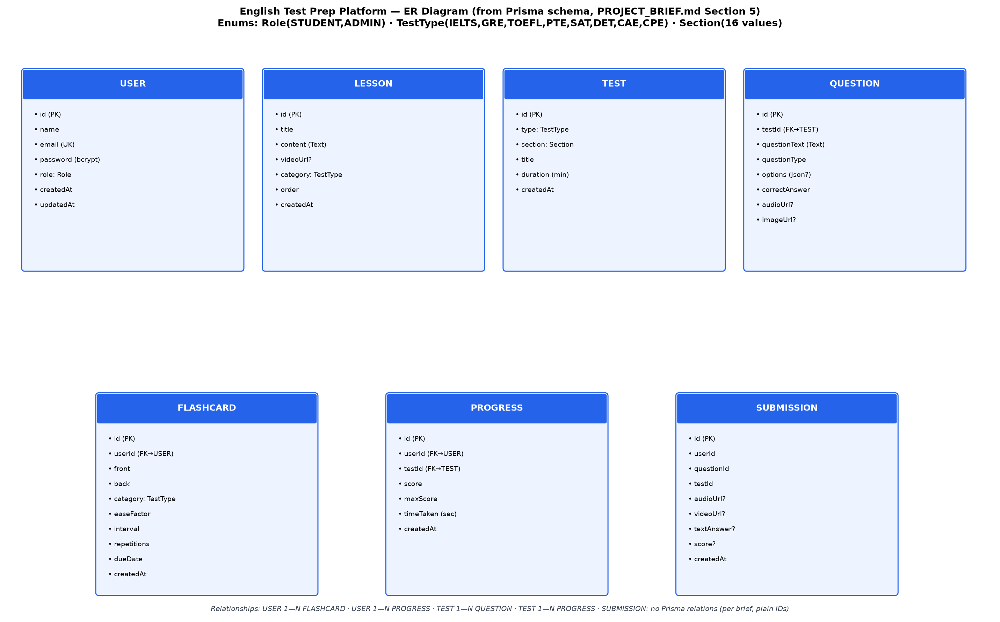
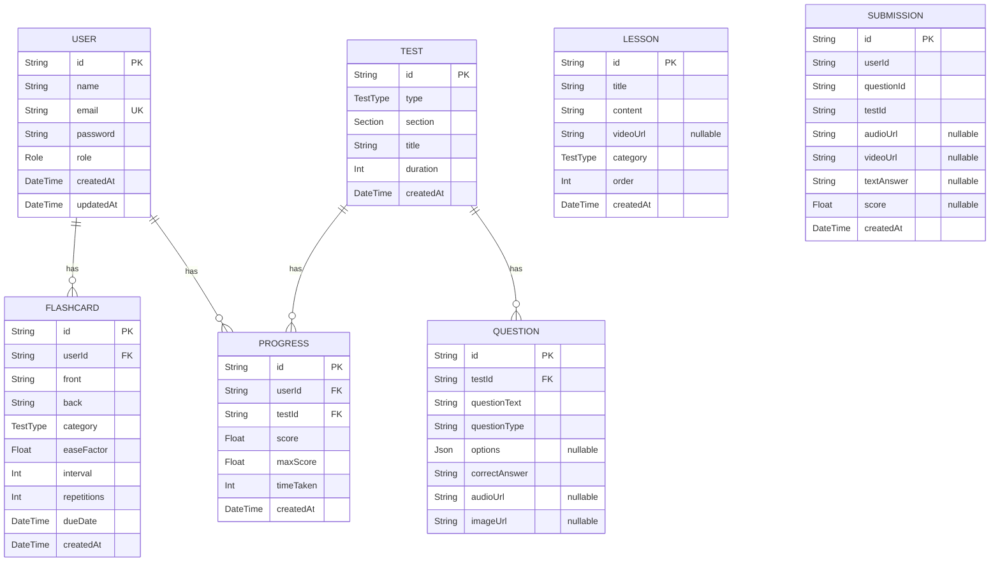

# ER Diagram — English Test Prep Platform

Generated from `backend/src/prisma/schema.prisma` (PROJECT_BRIEF.md
Section 5, implemented in Phase 2). Field/enum names match the
schema exactly. `ER_DIAGRAM.png` (above) is the exported image;
the Mermaid source below is the canonical version-controlled
diagram — render it at <https://mermaid.live> to regenerate.

## Notes
- `Submission` intentionally has **no Prisma relations** in the
  brief's schema (plain `userId` / `questionId` / `testId` strings)
  — preserved exactly as specified; do not add relations without
  approval (Final Instruction 4).
- Enums: `Role` (STUDENT, ADMIN), `TestType` (IELTS, GRE, TOEFL,
  PTE, SAT, DET, CAE, CPE), `Section` (16 values — see schema).
